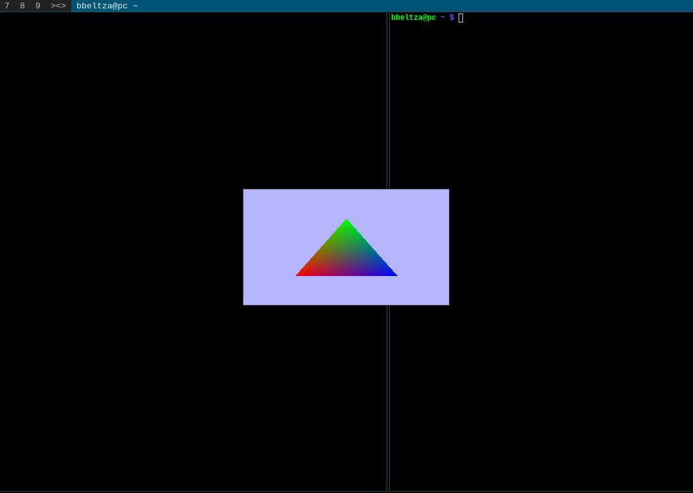

# An X client running remotely on Windows!



Small little project named "X11WinSock", for short, it's a demonstration of an X client running remotely from a Windows machine.
For long, it uses WinSock 2 to connect to a remote X server that has been configured correctly to listen to remote connections, and to send the correct requests to create a window, display it, and draw stuff on it. From the Windows machine, it also uses Direct3D 9 to open a device, and rasterize a triangle (the typical Hello Triangle) that would then be sent to the X server to be displayed on the window.

It's a niche project that took a few days to make since I've started getting interested in the different Linux/Unix protocols used for porting stuff to other platforms. Also one of the craziest "Hello Triangle"s that I've made!
Since X uses sockets internally, and can run over the network, I've started experimenting with getting an X client to run with raw unix sockets (so without any client libraries like Xlib or xcb), and then made this! Though for porting I'm fine with using xcb, this made me learn more about the protocol that I didn't quite understand back then, and thus made me understand more how to use those client libraries.

## Building

### Requirements

- Two computers, one with Windows, and another one with a Unix-like system that supports X11.

- For the host Unix machine:
  - An X server, of course, Xorg is the most used one and the one it was tested on.
  - An internet connection.
  - `startx` is recommended.
  - A window manager is also recommended, or better you can have a desktop environment (use Xwayland if it supports wayland or run it in X11 mode if it's supported).
  - An SSH server is also recommended, more on that later.

- For the client Windows machine:
  - MSVC: Visual Studio or Visual Studio Build tools. Instructions for building on MinGW aren't provided and therefore it is not tested nor supported.
  - SSH is recommended, this is installed by default on Windows.

To build the program, simply inside the repository's directory, type:
    ``` bat
    build.bat
    ```

## Running

Running a project that operates on multiple machines is a complex task, that's why there are instructions on running this program.
You need the two computers running.

### Running on the Unix machine

For the host Unix machine, start the X server with the `-broadcast` option:
``` sh
X -broadcast -keeptty "vt$XDG_VTNR"
```

If you use `startx`, you can place a `.xserverrc` file in your home directory (so `~/.xserverrc`) with the X server options:
``` bash
exec /usr/bin/X -broadcast -keeptty "$@" "vt$XDG_VTNR"
```

and then simply:
``` sh
startx
```

You also need to determine the ip address of the host machine (with a tool like `ifconfig`), you can definitely use the local address, in fact, using the global ip address of your network is **not recommended at all**.
Then, you also need a magic cookie used to authenticate to the X server from the Windows machine, only "MIT-MAGIC-COOKIE-1" is supported, after opening the X session, bring a terminal, and run:
``` sh
xauth list
```

This will show a list of displays with the magic cookie, something like this:
``` sh
@name/unix:0  MIT-MAGIC-COOKIE-1  d788ac03e55147b6c84858977829e4f3
```

The cookie is totally random and differs from session to session, so everytime you open an X session, you need to get that cookie.

> The reason why having SSH is recommended, is so that you can have that cookie from your Windows machine directly, simply connect to the host machine (with `ssh (user)@(ip address)`) and call `xauth list` from there, this will let you copy the cookie into the program's arguments.

### Running on the Windows machine

Make sure you have your Unix machine running the X server, then, in the program's directory, type:
``` bat
out\main (ip address):(optional port starting from 6000) (magic cookie)
```

This should show a small window on the host machine, with a triangle drawn on it! If you resize the window, everything will be cleared, I haven't handled that correctly and probably will not handle it!
